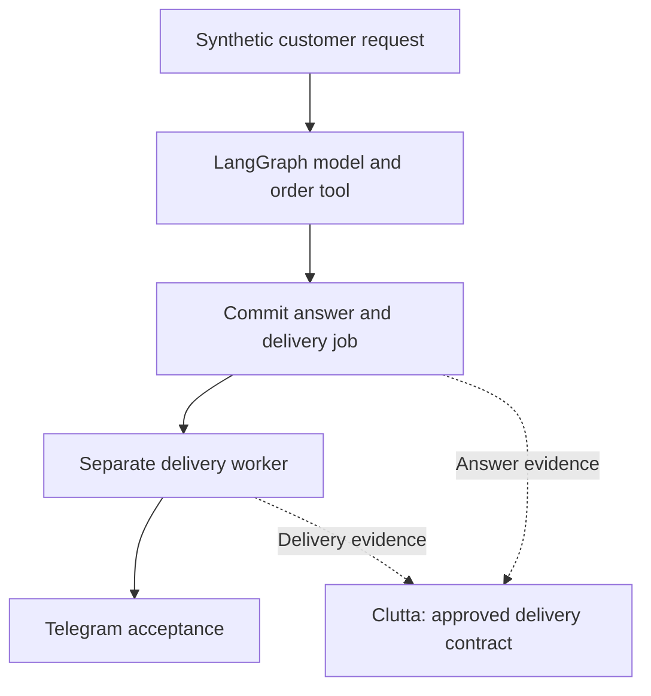

# Agent answer and delivery handoff

Status: implementation foundation, not a verified connected Clutta demo.

A real LangGraph graph calls `lookup_order`, generates an answer, then commits
the answer and its delivery job in one PostgreSQL transaction. A separate
worker attempts delivery. The controlled fault strands that job after an
injected rate-limit response while preserving the generated answer.

## What is real, and what is simulated

| Mode | Agent model | Destination evidence |
| --- | --- | --- |
| Default local contracts | Explicit fixture model inside the real LangGraph graph | Explicit sandbox transport |
| Live demonstration | Claude through `@langchain/anthropic`, with an operator-selected model ID | Telegram `sendMessage` response |
| Controlled fault | Either model mode | Adapter-injected rate limit; no Telegram send occurs |

Fixture results are not LLM results. Sandbox acceptance is not Telegram
acceptance. A request fixes its delivery mode at creation; the worker rejects
an attempt to mix modes. Fault injection is recorded in the delivery logs.
This does not claim that LangGraph or Telegram caused the injected retry bug.

## Design



The graph ends after persistence. It does not include Telegram delivery as
an agent tool. A completed graph run therefore cannot stand in for delivery.
The database makes the answer/outbox handoff durable; persistent LangGraph
checkpoints and restart of an unfinished model run are not implemented here.

## Local setup

Requirements: Node.js 20+, PostgreSQL, and a dedicated database named
`clutta_agent_delivery_lab`. Configure standard `PGHOST`, `PGPORT`, `PGUSER`,
`PGPASSWORD`, and `PGDATABASE` privately. Do not use production access.
The CLI refuses a different database name. It creates only its `lab_*` tables,
seeds synthetic order 1042, and never drops tables or clears previous evidence.

```bash
cd scenarios/agent-delivery
npm ci --ignore-scripts
export PGDATABASE=clutta_agent_delivery_lab
export AGENT_MODEL_MODE=fixture
export AGENT_DELIVERY_MODE=sandbox
npm run lab -- init
npm run lab -- request
```

Copy the printed `answer_id` into the commands below. It is a local identifier,
not a credential. The request command does not deliver its answer automatically.

```bash
npm run lab -- deliver ANSWER_ID retry-stall
npm run lab -- status ANSWER_ID
npm run lab -- repair ANSWER_ID
npm run lab -- deliver ANSWER_ID
npm run lab -- status ANSWER_ID
```

Expected database states: `pending`, `stalled`, `pending`, then `accepted`.
A separate fresh request with `deliver ANSWER_ID` is the healthy control.
`rate-limit` schedules a retry in one second; a subsequent normal delivery
before that time makes no attempt. These are application states, not Clutta
findings or a local substitute for Clutta's deadline evaluator.

Evidence goes to `~/sanitized-cases/clutta-agent-delivery/logs/`, with restrictive
file permissions. `AGENT_DELIVERY_DATA_ROOT` can select another directory
outside the checkout. Logs contain IDs, times, mode labels, and destination
hashes, not reply text, tokens, or raw chat IDs. Destination hashes are
pseudonyms, not guaranteed anonymization. The database retains the synthetic
reply and lab destination. A commit can precede its log write, so a missing log
alone cannot establish that the operation never occurred.

## Live model and Telegram

Configure `ANTHROPIC_API_KEY`, `AGENT_MODEL`, `TELEGRAM_BOT_TOKEN`, and
`TELEGRAM_LAB_CHAT_ID` privately, without putting keys in commands, screenshots,
Git, or receipts. Select `AGENT_MODEL_MODE=anthropic` and
`AGENT_DELIVERY_MODE=telegram` before creating the request. Model calls may incur
provider charges. The supported provider adapter has not yet been exercised
with live credentials. No OpenAI model adapter is included in this foundation.

The Telegram adapter allows only the configured lab chat. Successful evidence
requires `ok=true`, a message ID, the matching chat ID, and matching text.
This proves Telegram accepted the message, not that the customer read it.
Network/response uncertainty is never automatically retried. If the process
dies while `sending`, that job also needs reconciliation before resending.
Exactly-once external delivery is not claimed.

External LangSmith tracing must be disabled. The CLI rejects the two tracing
flags when set to `true` or `1`. Collection remains scoped to these two lab logs.
There is no background process to stop in this foundation; preserve the lab
database and evidence directory when ending the session.

## Connected Clutta acceptance gate

The root `./lab` still operates only the existing scheduler scenario. Do not
point its payment-specific checks at this workload or list this new scenario
as a verified runnable Clutta lab yet.

The intended delivery contract has two required observations:

1. `answer.persisted` from the agent log, after the transaction commits.
2. `delivery.accepted` from the delivery log, after Telegram acceptance is saved.

Use `answer_id` as the unique delivery join key, carrying `request_id` and
destination identity as supporting evidence. `delivery.attempted` and
`delivery.rate_limited` are diagnostic evidence, not required completion steps.
The request and tool loop are outside this first delivery-only deadline.
A separate full-journey contract can monitor model execution later.

Generate actual healthy activity, inspect the learned candidate, and have a
human review and activate it. Confirm the runtime loaded that exact version
and source coverage before fault injection. A 15-second accelerated window is
a design target, not an automatic override of a learned/approved deadline.

Live validation must independently establish:

- Healthy delivery and successful retries have matching accepted evidence and
  completed Flow Runs, without false missing-step Case Files.
- The selected stalled answer remains undelivered past the actual approved
  deadline while scoped collection is ready. Clutta produces its own cited
  violation and Case File for that answer in the correct project.
- Loss of collection is distinguishable from delivery failure. A heartbeat
  alone is insufficient to prove coverage of both watched log files.
- Repair produces real acceptance for the same answer. Inspect late-step/late-
  flow evidence and original missing-step history. Automatic Case File
  resolution is not promised.
- Replay, collector restart, tenant routing, and fresh-account setup preserve
  evidence and identities. No scripted Clutta finding or automatic approval
  substitutes for a failing live check.

## Tests

```bash
npm test
npm run check
npm audit --omit=dev
AGENT_TEST_REAL_PG=1 npm test
```

Default tests use `pg-mem` plus the real LangGraph graph and transport contract
test doubles. They do not certify PostgreSQL rollback or concurrent connection
behavior. The real PostgreSQL run also tests transactional rollback on an
injected outbox-write failure. CI runs both against a dedicated fake-data
database, with no model, Telegram, or Clutta keys.

References: [LangGraph JavaScript quickstart](https://docs.langchain.com/oss/javascript/langgraph/quickstart),
[Telegram sendMessage](https://core.telegram.org/bots/api#sendmessage),
[Telegram retry_after](https://core.telegram.org/bots/api#responseparameters).
